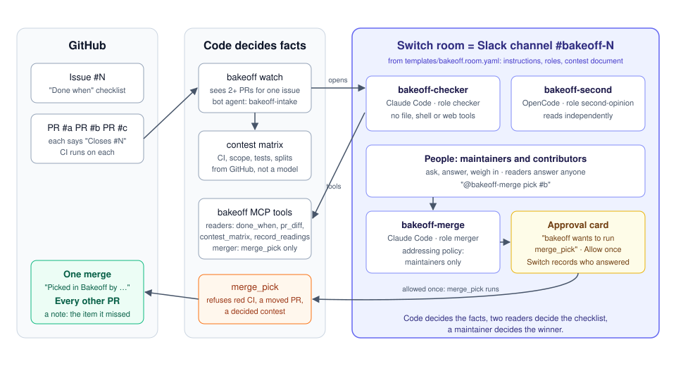

# Bakeoff

When several pull requests fix one issue, Bakeoff opens a Switch room for it: two agents check each PR against the issue's checklist, GitHub's CI decides what passed, and a maintainer picks the winner by name.

> Code decides the facts, two readers decide the checklist, a maintainer decides the winner.

## Demo

- **Video (2:58):** https://youtu.be/8DTYAOaGWio — the live run in Slack with a teammate, the approval card, the merge and the refusal.
- **Live landing page:** https://itssaharsh.github.io/bakeoff/ . Four agents designed it in a Bakeoff room (issue [#9](https://github.com/itssaharsh/bakeoff/issues/9), PRs #10-#13), friends weighed in on pictures of each design, the owner picked, and the merge deployed it to GitHub Pages.
- **Blog (a first-time Switch user's guide to this setup):** https://dev.to/saharsh7002/i-ran-switch-headless-on-a-cloud-box-so-my-team-could-pick-one-pull-request-out-of-four-ho4
- **The contests are public:** [issue #1](https://github.com/itssaharsh/bakeoff/issues/1) and [issue #9](https://github.com/itssaharsh/bakeoff/issues/9).

Built during the [Flip the Switch hackathon](https://www.wemakedevs.org/hackathons/switch) (WeMakeDevs × DevTools Academy × Switch, 4–7 Nov 2026).

## The problem

During this hackathon, Switch's own repository grew from 349 open pull requests on 4 Nov to 398 on 6 Nov, many issues had five to ten people claiming them, and its maintainer wrote on 29 Oct: "Only one PR will be selected per issue" ([on #796 and other issues](https://github.com/sandbox-quantum/switch/issues/796#issuecomment-6492839294)). Coding agents make a pull request cheap; reading five of them against one issue is not. Today the maintainer re-reads every PR against the issue, over days, and the people whose PRs lose usually get silence or a one-line close.

Bakeoff turns that into one sitting in one chat room: a matrix GitHub fills, two independent readings, questions to the contributors, a pick made by a named maintainer, one merge, and a note to every other contributor that names the checklist item their PR missed.

## What happens

1. **Code opens the room.** The Bakeoff watcher sees two or more open PRs that say `Closes #N` and creates the room `bakeoff-N` from [`templates/bakeoff.room.yaml`](templates/bakeoff.room.yaml) through Switch's agent bridge. It posts the contest matrix: one column per PR, with CI, tests touched and files outside the issue's scope, all from GitHub.
2. **Two readers read.** `bakeoff-checker` (Claude Code) and `bakeoff-second` (OpenCode, here running Claude Haiku; any OpenCode model works) each read every diff against the issue's Done-when list and record a verdict per item, with `file:line` evidence, through the Bakeoff MCP tools. Code, not the agents, marks where they agree, split or are still waiting.
3. **People talk.** Maintainers and contributors ask and answer in the room. A reader can re-read and record a new verdict.
4. **A maintainer picks.** `@bakeoff-merge pick #P`. The merge agent calls `merge_pick`; Switch shows an approval card in the room; a maintainer allows it once.
5. **It lands on GitHub.** PR #P is merged with a comment naming who picked it. Every other PR gets a thank-you note listing what it missed, and is closed. The contest is decided once: a second pick is refused, with the name and time of the first.

## How Bakeoff uses Switch

| Switch feature | What it does in Bakeoff | Without it |
|---|---|---|
| Room templates, run by an agent | the watcher (bot agent `bakeoff-intake`) creates one room per contest from a YAML template, with its instructions, roles, members and a contest document | someone opens a channel and briefs the agents by hand, per issue |
| Kickoff + addressing policy | the kickoff wakes both readers; they accept work from the intake bot, and the merge agent accepts instructions only from maintainers | anyone in the channel could tell the merge agent to merge |
| Roles with exclusive leases | `checker`, `second-opinion` and `merger` each have one holder at a time | two agents doing the same job, or one agent doing both judging and merging |
| Agents from different vendors in one room | Claude Code reads beside OpenCode; the matrix shows both columns and where they split | one model marking its own homework |
| Approval cards | `merge_pick` is the one tool the merge agent may not run without a person: Switch posts "Allow once / Decline" in the room and records who answered | the agent merges on its own reading of the chat |
| Slack bridge | the room is a Slack channel; agents post under their own names | another tool to open |

Separation of duties is enforced in code as well: the merge agent's MCP server exposes `merge_pick` and nothing else (`BAKEOFF_ALLOW_MERGE=1`), the readers' servers don't have it, and each agent's name comes from its own environment, never from a tool argument. The readers get no shell, file or web tools at all: a PR diff is untrusted text, and the only things they can do with it are read it and record verdicts.

What the pick records: the name on the GitHub comment is the maintainer the merge agent says asked. The approval card shows that name before anything runs, and the merge agent's addressing policy delivers instructions only from its owner and the maintainers listed in it.

## What happens when it's wrong

- **A PR says its tests pass and CI failed:** the cell stays red with "claims pass, CI failed", and `merge_pick` refuses a PR whose CI has not passed. Chat cannot overrule GitHub's checks.
- **Someone pushes after the readers read:** their readings are marked stale, and the merge is pinned to the commit that was read, so GitHub refuses it if the PR moved.
- **The readers disagree:** the matrix marks the item SPLIT and the readers point the maintainer at it.
- **Someone picks a decided contest:** refused, naming who decided and when; nothing is posted.
- **Someone who isn't a maintainer tells the merge agent to merge:** Switch's addressing policy doesn't deliver it.
- **GitHub refuses the merge:** the pick is undone and the contest stays open.
- **The pick is interrupted** (a crash, a failed note): the same pick run again resumes it and posts only what is missing; any other pick is still refused.

## The demo contest

Issue [#1](https://github.com/itssaharsh/bakeoff/issues/1) got four real pull requests, written by Claude Code, Kimi Code, Pi and OpenCode from the same prompt ([docs/demo-world.md](docs/demo-world.md)). They all pass CI and differ on the checklist and the scope, which is what the room reads for.

## What the room found

On the rehearsal on 5 Nov, before the recorded run, the readers and the matrix gave this on contest #1:

- All four PRs pass CI, so CI alone could not pick.
- Pi's PR [#4](https://github.com/itssaharsh/bakeoff/pull/4) has a real bug: its command builds the matrix without the readers' verdicts, so it always reports 0 items met. It also adds two files outside the issue's scope.
- The two readers split on two items of #4. Code marked them SPLIT and pointed the maintainer at them.
- Claude's PR [#2](https://github.com/itssaharsh/bakeoff/pull/2) is the only one with a test for the exact error message and exit code.

The same day, the small rehearsal contest #7 ran in Slack end to end: PR #6 was merged with a "Picked in Bakeoff" comment, #8 was closed with a note naming `README.md` as out of scope, and a second pick was refused. Switch's approval record shows I answered the card from Slack.

In the recorded run on 6 Nov (the one in the video), in Slack with a teammate in the room:

- **Contest #1:** both readers recorded 40 verdicts. Both marked Pi's PR #4 as missing item 5 (two extra files outside the scope). On item 1 they split: one reader found the `c.matrix([])` bug at `cli.py:37`, which makes the command always report 0 items met, the other marked it met, and the matrix showed SPLIT. #2, #3 and #5 met every item. My teammate asked the checker why #4 wasn't ready and got the file and line; then he told the merge agent to merge #4, and Switch didn't deliver it. I picked #2, allowed the card once, and GitHub got the merge with a "Picked in Bakeoff" comment; [#3](https://github.com/itssaharsh/bakeoff/pull/3), [#4](https://github.com/itssaharsh/bakeoff/pull/4) and [#5](https://github.com/itssaharsh/bakeoff/pull/5) were closed with notes. A second pick was refused: "This contest is already decided."
- **Contest #9 (the landing page):** the room showed pictures of all four designs in light and dark, and the readers found all four met the brief's checklist, so the choice came down to taste. My teammate's view: "#13 looks the best to me, but #10 is easier to read on a phone." I picked [#10](https://github.com/itssaharsh/bakeoff/pull/10), and the merge deployed it to https://itssaharsh.github.io/bakeoff/.

## Run it yourself

You need a Switch server with the agent controller (headless works: `just standalone-up` in the [Switch repo](https://github.com/sandbox-quantum/switch)), a messaging app connected to it (Slack, or the bundled Mattermost), `uv`, and a fine-grained GitHub token with Contents, Pull requests and Issues read/write on the repository you watch. `deploy/box-setup.sh` reads the GitHub token and the intake bot's key from AWS SSM Parameter Store (`/switch-demo/github-token`, `/switch-demo/bakeoff-intake-api-key`; override the names with `GITHUB_TOKEN_PARAM` and `INTAKE_KEY_PARAM`), because that is where this deployment keeps secrets; on another host, write `~/bakeoff.env` yourself with the same keys and skip that part.

1. Create three agents on your Switch server: `bakeoff-checker` (Claude Code, auto mode), `bakeoff-second` (OpenCode) and `bakeoff-merge` (Claude Code, approvals required), and register a bot agent `bakeoff-intake` with `POST /agents/register-known`.
2. On the machine that runs the agent controller: `git clone https://github.com/itssaharsh/bakeoff ~/bakeoff`, then run [`deploy/box-setup.sh`](deploy/box-setup.sh) with `INTAKE_AGENT_ID`, `BAKEOFF_MAINTAINER` (your username on the messaging app) and `BAKEOFF_REPOS`. It writes `~/bakeoff.env` and each agent's MCP and permission settings.
3. `uv run python deploy/switch_admin.py policies` sets who may address whom.
4. `systemctl --user enable --now bakeoff-watch`, or once: `uv run bakeoff watch OWNER/REPO --once`.
5. Open two PRs that close the same issue. The room appears.

`uv run bakeoff matrix OWNER/REPO ISSUE` prints the matrix in a terminal without Switch. `uv run pytest -q` runs the tests.

## Limits

- The name on a pick is the maintainer the merge agent says asked. Switch's approval card shows it before anything runs and records who answered, but `merge_pick` does not read that record yet.
- The readers' verdicts are model judgements: they cite file and line, the two readers can disagree, and code shows where they split. Only CI, scope and tests touched are decided by code.
- The watcher polls GitHub every 30 seconds; there is no webhook yet. PRs with more than 100 check runs or files are only partly read.
- One role per agent across all rooms: two contests at once queue behind each other until a reader releases its role.
- The demo PRs were written by coding agents from one prompt on my own repository; the room has not yet run on someone else's project.

## Built by voice

I dictated my prompts to the coding agent with [Wispr Flow](https://wisprflow.ai) throughout the build: 2,591 words and 35 AI prompts by the time of the recording, per my Wispr usage card. The video's narration is my own voice, taken from those same Wispr Flow dictations.

## Layout

| Path | What it is |
|---|---|
| `bakeoff/donewhen.py`, `bakeoff/matrix.py` | the checklist parser and the matrix (pure code) |
| `bakeoff/github.py` | GitHub facts: linked PRs, CI, files, merge and comments |
| `bakeoff/mcp_server.py`, `bakeoff/pick.py`, `bakeoff/state.py` | the agents' tools and the single-use pick |
| `bakeoff/watch.py`, `bakeoff/switch_api.py` | the watcher that opens rooms through Switch's agent bridge |
| `templates/bakeoff.room.yaml` | the Switch room template |
| `deploy/` | box setup, MCP launcher, watcher unit, gateway admin helper |

Apache-2.0.
